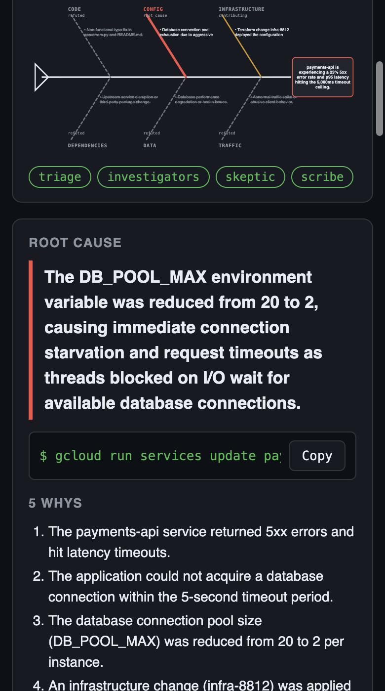

# Ishikawa RCA

> A multi-agent incident investigator that applies factory-floor root-cause analysis (fishbone / 5-Whys / 8D) to cloud outages: six parallel investigators gather evidence, a Skeptic agent tries to falsify every hypothesis, and you get the culprit commit, a one-line fix, and a fishbone diagram in under a minute.



---

## Overview

### Problem Statement & Intended Users
- **Problem**: When an alert fires at 3 AM, on-call engineers spend the first 30–60 minutes doing the same thing: scrolling logs, diffing recent deploys, eyeballing dashboards, and chasing correlations that turn out to be red herrings ("traffic went up, it must be traffic"). LLM "chat with your logs" tools make this worse by confidently picking the first correlation they see.
- **Intended Users**: SRE / on-call / platform engineers running services on Cloud Run (or any platform with logs, metrics and a git history), and teams that want written, evidence-backed postmortems.

### Key Features
- **Fishbone decomposition**: six investigator agents (code, config, infrastructure, dependencies, data, traffic) run **in parallel**, each restricted to the tools for its branch of the Ishikawa diagram.
- **Adversarial Skeptic**: before anything is reported, a Skeptic agent applies three falsification tests (timing, counterfactual, mechanism) to every hypothesis and separates *symptoms* (pool exhaustion, cold starts) from *causes*. Red herrings are kept in the report, marked refuted, with the evidence that killed them.
- **Structured, actionable output**: a schema-validated report with root cause, culprit (commit sha / config key / package), an exact containment command, 5-Whys down to the process gap, and corrective + preventive actions.
- **Live web UI**: the fishbone fills in bone by bone as agents work, with a streaming feed of every tool call.
- **Markdown postmortem** with a Mermaid fishbone that renders natively on GitHub ([example](examples/payments-5xx.md)).
- **Reproducible offline**: ships with three recorded incidents (fixtures) so anyone can run it with only a Gemini key; `--repo` switches deploy/diff tools to a real git history.

---

## Technical Stack

- **Language & Runtime**: Python 3.10+
- **Agent Framework**: [Google Agent Development Kit (ADK)](https://google.github.io/adk-docs/): `SequentialAgent`, `ParallelAgent`, `LlmAgent`, `BuiltInPlanner`, `output_schema`, session state
- **Models**: Gemini 3 Flash (default, `gemini-3-flash-preview`) via Google AI Studio or Vertex AI; any Gemini model with function calling works
- **Web**: FastAPI + Server-Sent Events, dependency-free HTML/SVG front end
- **External APIs / Tools**: none required. Evidence comes from JSON fixtures, or `git log` / `git show` on a local repo

---

## Architecture & Data Flow

```
                        ┌───────────────────────────── session state ─────────────────────────────┐
 alert ─▶ TRIAGE ──────▶│ triage brief: effect, suspect window, deploys in window                 │
          (get_alert,   └─────────────────────────────────────────────────────────────────────────┘
           list_recent_deploys)               │
                                              ▼
            ┌──────────── ParallelAgent "fishbone" (6 LlmAgents, concurrent) ─────────────┐
            │  CODE        CONFIG        INFRASTRUCTURE   DEPENDENCIES   DATA     TRAFFIC  │
            │  diffs,      revision env  metrics,         lockfile       DB stats  volume,  │
            │  logs        changes       probes           changes        queries   campaigns│
            └──────┬───────────┬──────────────┬────────────────┬────────────┬─────────┬──────┘
                   └───────────┴──── bone_<category> hypotheses + evidence ┴─────────┘
                                              ▼
                     SKEPTIC (all tools, deeper thinking)
                     timing test · counterfactual test · mechanism test
                     → ROOT CAUSE / CONTRIBUTING / REFUTED / INCONCLUSIVE
                                              ▼
                     SCRIBE (output_schema = RCAReport, Pydantic)
                                              ▼
              CLI summary · Markdown + Mermaid fishbone · live web fishbone (SSE)
```

Design choices:
- **Tool scoping per bone** keeps each investigator focused and prevents six agents from producing six copies of the same answer.
- **Thinking budget where it matters**: investigators run with `LOW` thinking (they gather facts); only the Skeptic gets `MEDIUM`. This cut a full investigation from ~290 s to ~40 s with no loss in accuracy on the bundled incidents.
- **State hand-off, not chat history**: each stage writes one `output_key`; later prompts reference `{bone_code}`, `{verdicts}` etc. so the context stays small.

Files:

| Path | Purpose |
| :--- | :--- |
| `ishikawa/agent.py` | Agent graph and prompts (`root_agent` for `adk web`) |
| `ishikawa/tools.py` | Evidence tools (fixtures or live git) |
| `ishikawa/schema.py` | `RCAReport` Pydantic schema |
| `ishikawa/runner.py` | Runs the graph, streams progress events |
| `ishikawa/render.py` | Markdown + Mermaid fishbone renderer |
| `ishikawa/__main__.py` | CLI |
| `server.py`, `web/index.html` | Live fishbone web UI |
| `fixtures/*.json` | Three recorded incidents |
| `tests/` | Offline test suite (no API key needed) |

---

## Prerequisites

- Python 3.10+
- `pip` (or `uv`)
- **One** of:
  - a Gemini API key from [Google AI Studio](https://aistudio.google.com/apikey), or
  - a GCP project with Vertex AI enabled and `gcloud auth application-default login`

---

## Installation & Setup

1. **Navigate to the project directory:**
   ```bash
   cd agents/ishikawa-rca
   ```

2. **Create a virtual environment and install dependencies:**
   ```bash
   python -m venv .venv
   source .venv/bin/activate      # Windows: .venv\Scripts\activate
   pip install -r requirements.txt
   ```

3. **Configure environment variables:**
   ```bash
   cp .env.example .env
   # then set GOOGLE_API_KEY (AI Studio) or the Vertex AI block
   ```

---

## Configuration & Environment Variables

| Variable Name | Required | Default | Description |
| :--- | :--- | :--- | :--- |
| `GOOGLE_API_KEY` | Yes, for AI Studio | *None* | Gemini API key |
| `GOOGLE_GENAI_USE_VERTEXAI` | No | `FALSE` | `TRUE` to use Vertex AI with ADC instead of an API key |
| `GOOGLE_CLOUD_PROJECT` | Yes, for Vertex | *None* | GCP project id |
| `GOOGLE_CLOUD_LOCATION` | Yes, for Vertex | *None* | e.g. `global` |
| `ISHIKAWA_MODEL` | No | `gemini-3-flash-preview` | Any Gemini model with function calling (e.g. `gemini-2.5-flash`) |
| `PORT` | No | `8080` | Web UI port (when using the uvicorn command below) |

---

## How to Run

**CLI**
```bash
python -m ishikawa --list                                   # show bundled incidents
python -m ishikawa --incident payments-5xx --out rca.md      # investigate + write postmortem
python -m ishikawa --incident checkout-latency --repo ~/code/checkout-api   # use a real git history for deploys/diffs
```

**Live fishbone web UI**
```bash
uvicorn server:app --port 8080
# open http://localhost:8080, pick an incident, press Investigate
```

**ADK dev UI** (inspect every event, state change and tool call)
```bash
adk web .
# choose "ishikawa", then type e.g. "investigate search-crashloop"
```

---

## Example Input & Output

### Example Input
```bash
python -m ishikawa --incident payments-5xx
```
Alert: `payments-api` 5xx ratio 23% (baseline 0.1%). Two changes landed in the window: a docs typo fix (`e44b7a1`) and a Terraform change (`infra-8812`).

### Example Output (abridged, real run)
```
── TRIAGE ── (t+4.1s)
── DATA ── (t+9.4s)            ...active connections dropped 72 → 16, DB CPU 41% → 15%: DB is idle, app can't get connections
── TRAFFIC ── (t+9.6s)         ...900 → 940 rpm, within normal band
── INFRASTRUCTURE ── (t+10.7s) ...CPU dropped 30% → 12%: service is blocked on I/O, not compute
── CONFIG ── (t+14.8s)         ...revision payments-api-00043-vow changed DB_POOL_MAX 20 → 2
── SKEPTIC ── (t+30.3s)
REFUTED: CODE: Commit e44b7a1 is a documentation-only typo fix and does not affect application logic.
ROOT CAUSE: CONFIG: infra-8812 reduced DB_POOL_MAX from 20 to 2, triggering QueuePool exhaustion and 5,000ms timeouts.
REFUTED: DEPENDENCIES: No lockfile changes occurred in the last 14 days.
CONTRIBUTING: DATA: DB is under-utilised because the application cannot acquire connections.
REFUTED: TRAFFIC: Traffic stable at ~940 RPM, does not correlate with the error spike.

🎯 ROOT CAUSE: infra-8812 reduced DB_POOL_MAX from 20 to 2 ... leading to QueuePool exhaustion and connection timeouts.
   culprit: DB_POOL_MAX
   fix now: gcloud run services update payments-api --set-env-vars DB_POOL_MAX=20
   (37.5s)
```

Full generated postmortems with Mermaid fishbones: [`examples/`](examples/).

### Bundled incidents

| Incident | Real root cause | Red herrings the Skeptic must reject |
| :--- | :--- | :--- |
| `checkout-latency` | N+1 query introduced in commit `a1f3c9e` | +18% traffic from a marketing email; `LOG_LEVEL=debug` change; DB pool exhaustion (a symptom) |
| `payments-5xx` | Terraform set `DB_POOL_MAX` 20 → 2 | Code deploy 3 minutes earlier (docs-only) |
| `search-crashloop` | Dependabot bumped pydantic 1 → 2 (`BaseSettings` moved) | `minScale` change the night before; cold-start spike (a symptom) |

---

## How to Test

```bash
pytest            # 9 offline tests: fixtures, tools, live-git mode, agent graph, renderer, HTTP API. No API key needed.
```

Manual end-to-end check (needs a key): `python -m ishikawa --incident checkout-latency` should name `a1f3c9e` as the culprit and mark the traffic hypothesis as refuted or contributing (never root cause).

---

## Known Limitations

- Evidence sources for logs, metrics, config, DB and traffic are recorded fixtures. Live mode currently covers git history only; Cloud Logging / Cloud Monitoring connectors are the next step.
- LLM output varies between runs: verdicts on *contributing* factors can flip between `contributing` and `refuted`; the root cause has been stable across our runs of the bundled incidents, but this is not a guarantee.
- End-to-end latency is ~35–70 s with Gemini 3 Flash, dominated by the Skeptic step.
- ADK 2.x marks `SequentialAgent` / `ParallelAgent` as deprecated in favour of `Workflow`; they still work, and we will migrate when `Workflow` supports this composition.
- Single incident per run; no persistence of past incidents yet.

---

## Security & Privacy Considerations

- **Secrets Handling**: credentials are read from environment variables / `.env` (git-ignored) or Google Application Default Credentials. Nothing is hard-coded.
- **Data Privacy**: incident evidence (log lines, diffs, metrics) is sent to the Gemini API for analysis. Do not point it at logs containing personal data unless your Gemini / Vertex AI terms allow it. Bundled fixtures are synthetic.
- **Safety**: the agent is **read-only**. It never executes the fix it proposes; `immediate_fix` is text for a human to review. The only subprocess is `git log` / `git show` with a validated sha, run inside the repo you pass with `--repo`. Incident ids are validated against a strict pattern to prevent path traversal.

---

## Future Improvements

- [ ] Live connectors: Cloud Logging, Cloud Monitoring, Cloud Run revisions API, Cloud SQL Insights
- [ ] Auto-open a revert PR on GitHub for code root causes (human approval gate)
- [ ] Incident memory in Firestore: "this looks like INC-142 from March" (8D step D7, prevent recurrence)
- [ ] Expose the evidence tools as an MCP server so any agent can use them
- [ ] Slack / PagerDuty webhook trigger

---

## License

*This project is contributed under the repository's open-source license (MIT).*
