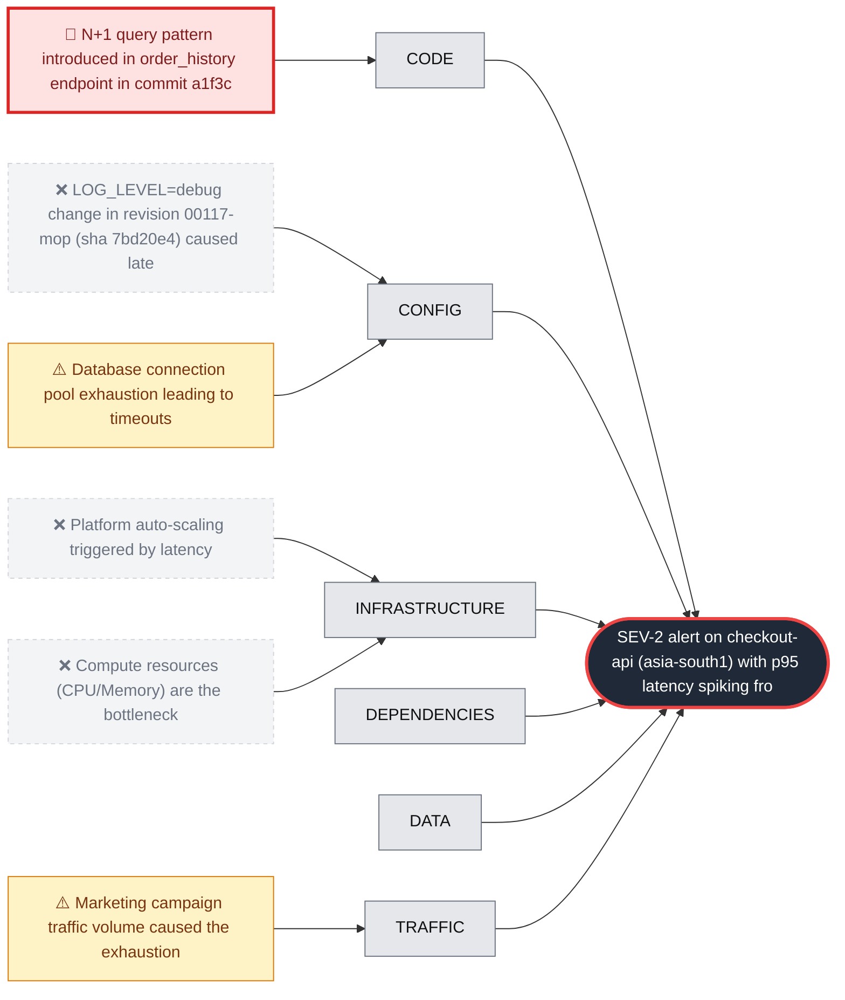

# RCA: Checkout API Latency Spike due to N+1 Query Pattern

**Effect:** SEV-2 alert on checkout-api (asia-south1) with p95 latency spiking from 180ms to 2,430ms and 504 errors.

**Root cause:** Commit a1f3c9e introduced an N+1 query pattern in the order history endpoint by replacing a single 'selectinload' query with nested loops that execute multiple database calls per order and item, exhausting the connection pool.

**Culprit:** `a1f3c9e`

**Immediate fix:** `git revert a1f3c9e`

## Fishbone

## Hypotheses examined

| Verdict | Category | Hypothesis | Confidence | Evidence |
| :--- | :--- | :--- | :--- | :--- |
| 🎯 root_cause | code | N+1 query pattern introduced in order_history endpoint in commit a1f3c9e | 100% | Code diff for a1f3c9e shows removal of selectinload(Order.items) replaced by nested db.query calls for OrderItem and Product.thumb_url db_queries_per_request_orders_history jumped from 3 to 58 at 09:31:30Z Logs show slow requests for /v1/orders/history taking >2,300ms with db_queries up to 74 |
| ⚠️ contributing | config | Database connection pool exhaustion leading to timeouts | 90% | db_connection_pool_utilization_pct hit 100% at 09:34:00Z Logs show 'sqlalchemy pool: checkout waited 640ms for connection (pool_size=10, in_use=10)' 504 upstream timeouts occurred while waiting for db connections |
| ⚠️ contributing | traffic | Marketing campaign traffic volume caused the exhaustion | 95% | Traffic increased 18% at 09:30Z, but a similar campaign on 2026-10-17 had no impact on latency (190ms) |
| ❌ refuted | config | LOG_LEVEL=debug change in revision 00117-mop (sha 7bd20e4) caused latency | 80% | LOG_LEVEL changed at 08:55:00Z, but latency remained at baseline for 36 minutes until the next code deploy |
| ❌ refuted | infrastructure | Platform auto-scaling triggered by latency | 90% | container_instance_count increased from 4 to 6 at 09:36:00Z, four minutes after the latency spike began at 09:32:00Z |
| ❌ refuted | infrastructure | Compute resources (CPU/Memory) are the bottleneck | 100% | cpu_utilization_pct (44%) and memory_utilization_pct (53%) remained stable and well below limits |

## 5 Whys

1. p95 latency for checkout-api spiked to 2,430ms and triggered a SEV-2 alert.
2. The database connection pool was exhausted, causing requests to wait or time out.
3. The number of database queries per order history request increased from 3 to 58.
4. Commit a1f3c9e replaced an efficient Eager Loading query with a nested loop performing N+1 queries to fetch thumbnails.
5. The code review process failed to identify the performance regression of removing 'selectinload' in favor of nested queries.

## Corrective actions

- [ ] Revert commit a1f3c9e to restore baseline performance.
- [ ] Restore the 'selectinload' or use a proper JOIN to fetch product thumbnails in a single query.

## Preventive actions

- [ ] Implement automated linting or static analysis to detect N+1 query patterns in SQLAlchemy.
- [ ] Add regression testing for database query counts per endpoint in the CI pipeline.
- [ ] Establish a performance testing phase for new features that modify core data fetching logic.
